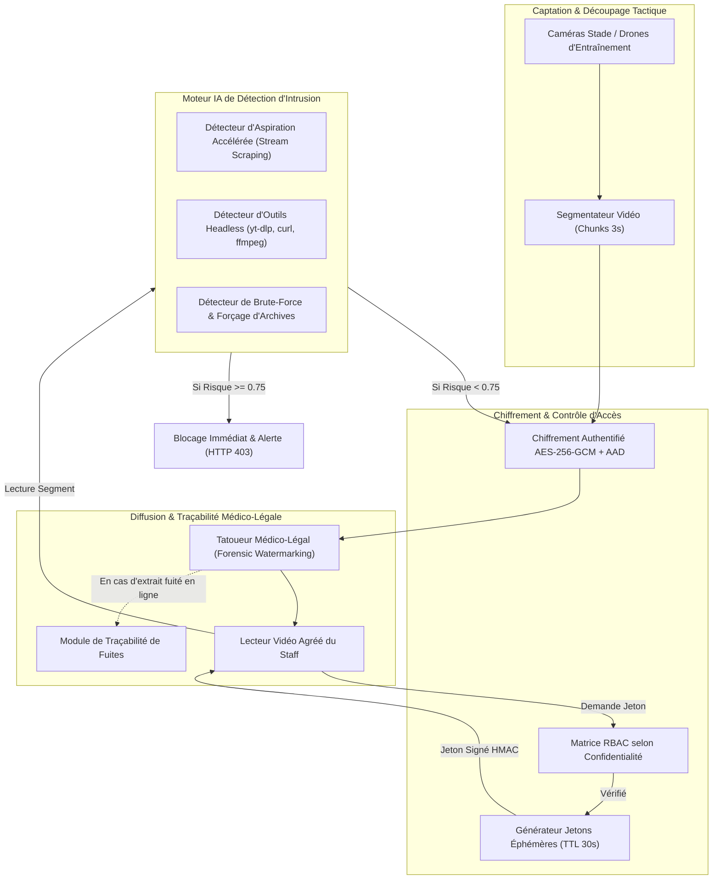

# Architecture Système - Protection des Flux & Systèmes d'Analyse Vidéo Tactique

## 1. Vue d'Ensemble & Protection des Actifs Sportifs

Les systèmes d'analyse vidéo tactique des clubs professionnels concentrent des secrets sportifs majeurs (schémas sur coups de pied arrêtés, failles adverses détectées, plans de jeu personnalisés). La plateforme applique une architecture Zero-Trust dédiée aux flux multimédias chunkés.

## 2. Principes Fondamentaux de Sécurité Multimédia

### 2.1 Chiffrement Granulaire des Segments Vidéo (AES-256-GCM)
Les flux ne transitent jamais en clair. Chaque segment de 3 secondes est chiffré individuellement avec un vecteur d'initialisation unique et les métadonnées `video_id:segment_index` injectées en données associées authentifiées (AAD). Cela empêche formellement la réinjection ou l'inversion de fragments.

### 2.2 Jetons Éphémères à Signature HMAC-SHA256 (TTL 30s)
L'accès aux segments vidéo requiert un jeton signé temporaire liant l'utilisateur, la vidéo et l'adresse IP du client. Tout partage de lien expire après 30 secondes et échoue immédiatement si l'adresse IP source change.

### 2.3 Tatouage Numérique Médico-Légal (Forensic Watermarking)
À chaque délivrance de flux, le moteur injecte dynamiquement en fin de paquet une signature stéganographique scellée contenant l'identifiant du spectateur, l'horodatage et l'IP source. Si un enregistrement d'écran ou un dump est diffusé illégalement sur les réseaux sociaux, le module `trace-leak` identifie instantanément l'auteur de la fuite.

### 2.4 Variante IA : Détection d'Intrusion sur Flux Vidéo
Le moteur comportemental analyse la cinématique des requêtes vidéo :
- **Aspiration Accélérée (Video Scraping) :** Détection d'aspirations à plus de 15x la vitesse réelle de lecture (téléchargement intégral d'un match en quelques secondes).
- **Empreinte de Grabbers Automatisés :** Détection d'outils comme `yt-dlp`, `ffmpeg`, `curl`, `python-requests`.
- **Forçage & Probing :** Blocage des tentatives répétées d'accès aux combinaisons secrètes.
